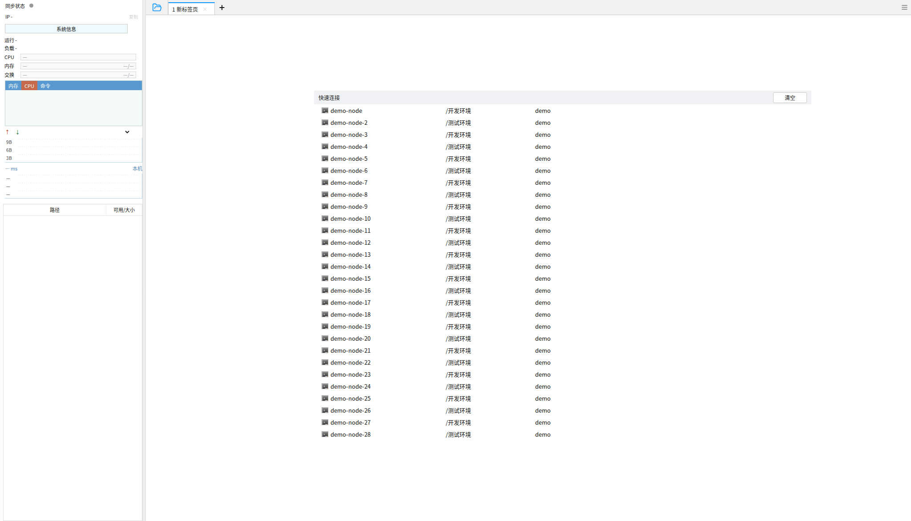
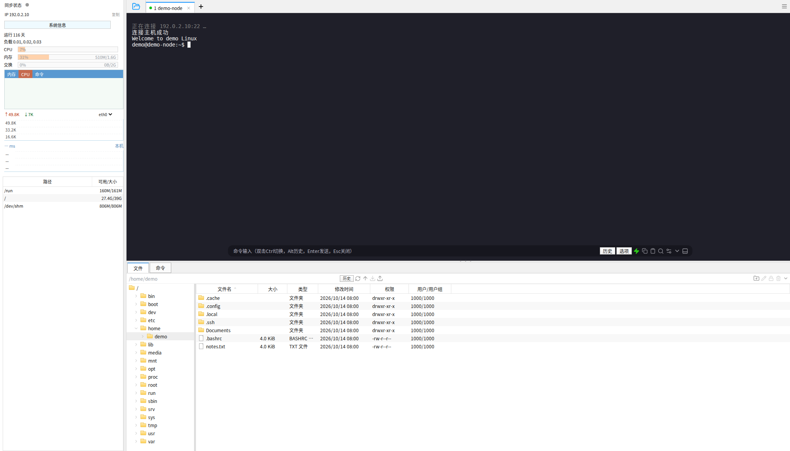

# 工作区界面

主工作区按用户提供的 FinalShell 4.6.5 新标签页、已连接窗口截图调整。下图来自 ShellDock 浏览器渲染，使用测试专用 IPC 桥和合成连接、文件及指标；不代表已连接真实主机。原始参考截图和真实主机信息不存入仓库。

## 新标签页

监控侧栏贯穿窗口全高，默认 320 px；右侧标签栏高 34 px。未连接时仅显示白色快速连接表格，所有保存的连接均可进入列表。“清空”只清除本次运行的快速连接条目，连接管理器仍保留配置。

## 已连接工作区

终端背景为 `#1f1f29`。文件区默认占右侧内容高度的 43%，目录树宽 180 px。文件表格显示名称、大小、类型、修改时间、Unix 权限和 UID/GID。侧栏宽度及终端 / 文件区高度可拖动分隔条或用方向键调整。

悬浮命令框支持 Enter 发送、Alt 历史、Esc 隐藏、双击 Ctrl 切换，并提供复制选区、粘贴、搜索和终端设置。快捷命令位于监控栏“命令”页和文件区“命令”页。连接管理、导入、导出、重连、断开和传输队列通过右上角菜单访问。

CPU、内存和网卡曲线使用每次 SSH 实际采集的数据，最多保留 120 次采样。缺失数值显示“—”；延迟测量尚未实现。UID/GID 尚未解析为用户名 / 组名。图标为独立实现，全部对话框尚未逐像素校准。

## 验证

Playwright 覆盖配置新建与编辑、28 个快速连接与清空语义、未连接状态、IPC 连接 / 文件 / 监控数据展示、真实目录调用、命令发送及历史、标签切换、最小窗口分隔条调整和过期目录响应隔离。文件权限格式测试覆盖普通文件、目录、符号链接和 setuid / setgid / sticky 位。测试桥仅存在于测试目录，不包含在生产应用中。
